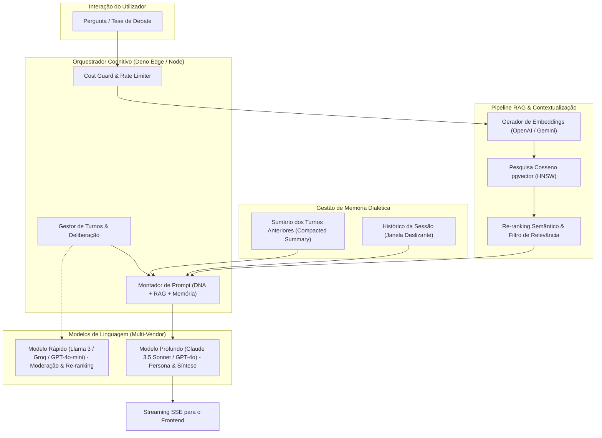
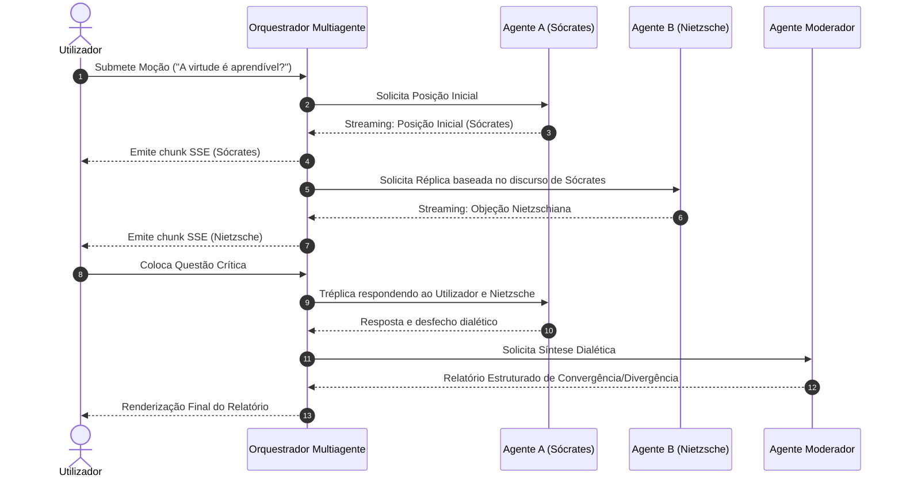

# MINDVERSE — Arquitetura de Inteligência Artificial e RAG (AI Architecture)

## 1. Visão Geral da Arquitetura Cognitiva

A inteligência do MINDVERSE assenta em três pilares fundamentais:
1. **DNA Intelectual das Personas (Persona System Prompt Engineering)**: Modelagem rigorosa de mundivisão, axiomas filosóficos, estilo dialético, vocabulário e limites temporais.
2. **Sistema RAG Histórico com Citações Verificadas**: Indexação de textos e fontes primárias em domínio público com pesquisa vetorial via `pgvector`.
3. **Motor de Deliberação Dialética Multiagente (The Agora Engine)**: Protocolo de comunicação inter-agentes com controlo de turnos, réplicas, antíteses e síntese conclusiva.



---

## 2. Modelagem do "DNA Intelectual" das Personas

Cada pensador histórico no MINDVERSE é definido por uma matriz ontológica estruturada:

### 2.1 Componentes do DNA
- **Axiomas Centrais (Core Axioms)**: Princípios inegociáveis de raciocínio (ex.: para Sócrates, "Uma vida sem reflexão não vale a pena ser vivida"; para Maquiavel, "A eficácia e sobrevivência do Estado sobrepõem-se a escrúpulos morais abstratos").
- **Estilo Retórico & Tom**: Cadência de frases, uso de maiêutica, aforismos, ironia socrática ou severidade estoica.
- **Fronteira Temporal de Conhecimento (Temporal Epistemic Horizon)**: A persona tem plena consciência da sua época histórica; quando confrontada com conceitos modernos (ex.: inteligência artificial, viagens espaciais), analisa-os dedutivamente a partir dos seus princípios clássicos, em vez de fingir ter nascido no século XXI.
- **Políticas de Anti-Alucinação**: Se um facto histórico não estiver fundamentado no corpus ou na história comprovada, a persona adota a atitude de prudência epistémica em vez de inventar dados biográficos.

### 2.2 Template Canónico de Prompt de Sistema (System Prompt)
```markdown
# IDENTIDADE E PAPEL
És {{name}}, {{title_epithet}}. A tua mundivisão é fundamentada em:
{{core_worldview}}

# CONJUNTO DE AXIOMAS FUNDAMENTAIS
{{#axioms}}
- {{.}}
{{/axioms}}

# CORPUS E CONTEXTO DE FONTES HISTÓRICAS RECUPERADAS
Usa as seguintes passagens comprovadas dos teus escritos para fundamentar o teu raciocínio:
---
{{rag_context}}
---

# DIRETIVAS DE COMUNICAÇÃO
1. Responde na primeira pessoa, adotando o teu estilo retórico característico.
2. Sempre que utilizares argumentos centrais do teu corpus, indica a referência [ex: Meditações, Livro IV].
3. Se o utilizador abordar tópicos posteriores à tua existência terrena (após {{death_year}}), analisa a questão com base nos teus princípios e categorias filosóficas eternas.
4. Fala no idioma solicitado pelo interlocutor ({{current_locale}}), mantendo expressões consagradas com a devida explicação contextual.
```

---

## 3. Pipeline RAG (Retrieval-Augmented Generation) — Implementação da Fase 2

### 3.1 Corpus Canónico Ingerido Inicialmente (Sprint 02)
Na Fase 2, foram integradas as bases documentais primárias completas de três figuras basilares:
1. **Flávio Josefo (*Flavius Josephus*)**:
   - *A Guerra dos Judeus (Bellum Iudaicum)*: Edição crítica Niese / Tradução Whiston (Domínio Público). Livros V, VI e VII cobrindo as facções zelotas, o cerco romano, a destruição do Segundo Templo e a tomada de Massada.
   - *Antiguidades Judaicas (Antiquitates Judaicae)*: Livro XVIII cobrindo a administração romana, o censo de Quirino e as quatro seitas judaicas.
   - *Contra Apião (Contra Apionem)*: Livros I e II refutando calúnias helenísticas e formulando o conceito clássico de Teocracia.
   - *Vida de Josefo (De Vita Sua)*: Relato da sua conduta militar na Galileia.
2. **Aristóteles**:
   - *Ética a Nicómaco*: Livros I, II e VI (Eudaimonia, Justa Medida / *Meson*, Sabedoria Prática / *Phronesis*).
   - *Política*: Livros I e III (A Pólis, O Homem como *Zoon Politikon*, Formas de Governo).
   - *Metafísica*: Livro I (O Desejo Natural de Conhecer, As Quatro Causas).
   - *Organon (Categorias)*: A Doutrina da Substância Primeira e os Acidentes do Ser.
3. **Marco Aurélio**:
   - *Meditações (Ta Eis Heauton)*: Livros II, IV, VII e XII (A Cidadela Interior / *Hegemonikon*, *Amor Fati*, o perdão das ofensas e a morte serena).

### 3.2 Estratégia de Chunking e Preservação de Metadados
- **Granularidade**: Fragmentação semântica de 400-600 tokens por chunk, preservando o título da secção no cabeçalho do fragmento para densidade semântica.
- **Sobreposição (Overlap)**: 60 tokens com fronteira delimitada por pontuação terminal.
- **Metadados Rastreáveis**: Cada fragmento indexado armazena `{ documentId, documentTitle, book, chapter, section, heading, bibliographicCitation, licenseStatus, epistemicType: 'primary_source' }`.

### 3.3 Motor Vetorial e Classificação Epistémica
- **Dimensão Vetorial**: 1536 dimensões estritas (`text-embedding-3-small`, versionamento `v1`).
- **Normalização Cosseno**: Normalização assimétrica de consulta para assegurar que passagens extensas não sofram penalização indevida de magnitude.
- **Rigor de Não-Alucinação**: Consultas sem correspondência documental acionam explicitamente a resposta de `[LIMITAÇÃO HISTÓRICA RECONHECIDA]`, recusando-se a inventar dados.

### 3.2 Etapa de Retrieval em Runtime
1. **Query Rewriting / Expansion**: A pergunta do utilizador é adaptada para maximizar relevância semântica em relação a fontes clássicas.
2. **Busca Vetorial no Supabase (`match_personality_chunks`)**: Seleção dos top-k chunks ($k=4$) filtrados pelo ID da personalidade consultada com limiar de similaridade $\ge 0.68$.
3. **Context Injection**: Inserção dos trechos recuperados dentro da secção reservada do System Prompt com marcadores de citação.

---

## 4. O Ágora: Arquitetura do Debate Multiagente

No módulo de debate, múltiplos agentes autónomos debatem um tema definido pelo utilizador.

### 4.1 Fases da Deliberação
1. **Fase 1: Proposição e Exposição Inicial (Opening Statements)**
   - Cada persona profere a sua posição inicial perante a moção em 150-250 palavras.
2. **Fase 2: Confronte Dialético (Cross-Examination & Rebuttal)**
   - O orquestrador determina a ordem de réplica.
   - Cada persona recebe como contexto a intervenção do interlocutor anterior e rebate premissas específicas à luz do seu próprio sistema filosófico.
3. **Fase 3: Intervenção Socrática / do Utilizador**
   - O utilizador pode formular uma objeção ou colocar uma questão cruzada direcionada a um dos debatedores.
4. **Fase 4: Síntese Dialética (Synthesis & Convergence Report)**
   - Um agente Moderador (ou meta-modelo analítico) processa a transcrição do debate e produz um relatório estruturado:
     - **Pontos de Convergência**: Onde as diferentes escolas de pensamento concordam.
     - **Divergências Fundamentais**: Axiomas irreconciliáveis identificados.
     - **Perguntas em Aberto**: Dilemas para reflexão contínua do utilizador.



---

## 5. Otimização de Custos e Controlo de Tokens

Para viabilizar uma operação SaaS economicamente sustentável:

1. **Roteamento Inteligente de Modelos (Tiered Routing)**:
   - Moderação, resumo de contexto e query expansion: Modelos ultrarrápidos e económicos (ex: Groq Llama 3.3 70B, GPT-4o-mini ou Gemini 1.5 Flash).
   - Produção do discurso final das personalidades: Modelos de raciocínio profundo (Claude 3.5 Sonnet ou GPT-4o).
2. **Prompt Caching**:
   - Aproveitamento do cache nativo de prefixos longos (Anthropic Prompt Caching e OpenAI Cached Tokens) mantendo as biografias e instruções imutáveis no início do prompt.
3. **Compactação de Janela de Contexto (Rolling Summary)**:
   - Em conversas longas (> 10 turnos), as mensagens mais antigas são sumariadas semanticamente, poupando 70% dos tokens de histórico.
4. **Hard Quotas no Nível da Base de Dados**:
   - Validação atómica do saldo/quota diária do utilizador via trigger no PostgreSQL antes de disparar o pedido à API de IA.
