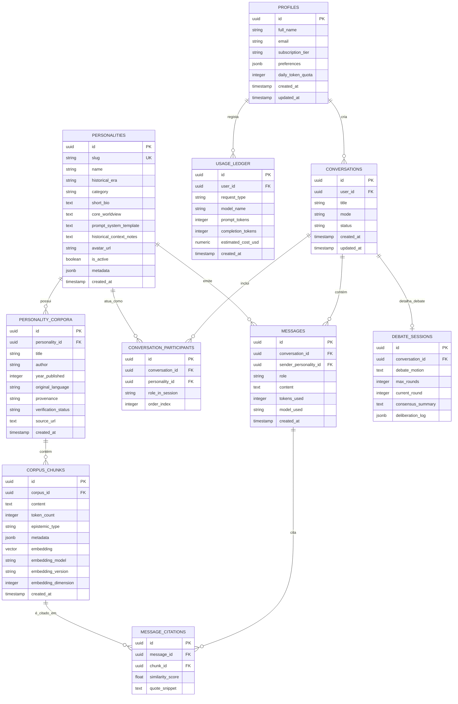

# MINDVERSE — Modelação e Design da Base de Dados (Database Design)

## 1. Visão Geral da Arquitetura de Dados

A persistência do MINDVERSE é construída sobre **PostgreSQL 15+** com a extensão **`pgvector`** habilitada no **Supabase**. Toda a camada relacional segue as formas normais rigorosas, utilizando UUIDs como chaves primárias, chaves forasteiras com integridade referencial, e políticas de **Row-Level Security (RLS)** ativas para garantir o isolamento estrito de dados entre inquilinos (multi-tenant safety).

---

## 2. Diagrama Entidade-Relacionamento (ERD)



---

## 3. Especificação do Esquema DDL (SQL)

### 3.1 Ativação de Extensões
```sql
CREATE EXTENSION IF NOT EXISTS "uuid-ossp";
CREATE EXTENSION IF NOT EXISTS "vector";
```

### 3.2 Tabela `profiles` (Perfis de Utilizador)
```sql
CREATE TABLE public.profiles (
    id UUID PRIMARY KEY REFERENCES auth.users(id) ON DELETE CASCADE,
    full_name TEXT,
    email TEXT NOT NULL,
    avatar_url TEXT,
    subscription_tier TEXT NOT NULL DEFAULT 'seeker' CHECK (subscription_tier IN ('seeker', 'scholar', 'institution')),
    daily_token_quota INTEGER NOT NULL DEFAULT 50000,
    preferences JSONB NOT NULL DEFAULT '{"locale": "pt", "theme": "dark", "socratic_intensity": "balanced"}'::jsonb,
    created_at TIMESTAMPTZ NOT NULL DEFAULT timezone('utc'::text, now()),
    updated_at TIMESTAMPTZ NOT NULL DEFAULT timezone('utc'::text, now())
);
```

### 3.3 Tabela `personalities` (Personas Históricas)
```sql
CREATE TABLE public.personalities (
    id UUID PRIMARY KEY DEFAULT uuid_generate_v4(),
    slug TEXT NOT NULL UNIQUE,
    name TEXT NOT NULL,
    title_epithet TEXT NOT NULL, -- ex: "O Imperador Filósofo"
    historical_era TEXT NOT NULL, -- ex: "Antiguidade Clássica", "Iluminismo"
    category TEXT NOT NULL CHECK (category IN ('philosophy', 'science', 'strategy', 'literature', 'arts', 'statesmanship')),
    short_bio TEXT NOT NULL,
    core_worldview TEXT NOT NULL,
    prompt_system_template TEXT NOT NULL,
    avatar_url TEXT,
    voice_preset JSONB, -- Configuração para text-to-speech futuro
    is_active BOOLEAN NOT NULL DEFAULT true,
    metadata JSONB NOT NULL DEFAULT '{}'::jsonb,
    created_at TIMESTAMPTZ NOT NULL DEFAULT timezone('utc'::text, now()),
    updated_at TIMESTAMPTZ NOT NULL DEFAULT timezone('utc'::text, now())
);
```

### 3.4 Tabelas do Corpus e RAG (`personality_corpora` e `corpus_chunks`)
```sql
CREATE TABLE public.personality_corpora (
    id UUID PRIMARY KEY DEFAULT uuid_generate_v4(),
    personality_id UUID NOT NULL REFERENCES public.personalities(id) ON DELETE CASCADE,
    title TEXT NOT NULL,
    author TEXT NOT NULL,
    year_published INTEGER,
    original_language TEXT NOT NULL DEFAULT 'en',
    source_url TEXT,
    license_status TEXT NOT NULL DEFAULT 'public_domain',
    created_at TIMESTAMPTZ NOT NULL DEFAULT timezone('utc'::text, now())
);

CREATE TABLE public.corpus_chunks (
    id UUID PRIMARY KEY DEFAULT uuid_generate_v4(),
    corpus_id UUID NOT NULL REFERENCES public.personality_corpora(id) ON DELETE CASCADE,
    content TEXT NOT NULL,
    token_count INTEGER NOT NULL,
    metadata JSONB NOT NULL DEFAULT '{}'::jsonb, -- { "chapter": "Livro IV", "section": "12", "page": 45 }
    embedding VECTOR(1536), -- Compatível com OpenAI text-embedding-3-small (ou 768 para Gemini)
    created_at TIMESTAMPTZ NOT NULL DEFAULT timezone('utc'::text, now())
);

-- Índice vetorial HNSW para pesquisa por similaridade cosseno de altíssima velocidade
CREATE INDEX idx_corpus_chunks_embedding ON public.corpus_chunks 
USING hnsw (embedding vector_cosine_ops)
WITH (m = 16, ef_construction = 64);

CREATE INDEX idx_corpus_chunks_corpus_id ON public.corpus_chunks(corpus_id);
```

### 3.5 Tabela de Conversações e Participantes
```sql
CREATE TABLE public.conversations (
    id UUID PRIMARY KEY DEFAULT uuid_generate_v4(),
    user_id UUID NOT NULL REFERENCES public.profiles(id) ON DELETE CASCADE,
    title TEXT NOT NULL DEFAULT 'Novo Diálogo',
    mode TEXT NOT NULL CHECK (mode IN ('solo', 'debate', 'inquiry')),
    status TEXT NOT NULL DEFAULT 'active' CHECK (status IN ('active', 'archived')),
    created_at TIMESTAMPTZ NOT NULL DEFAULT timezone('utc'::text, now()),
    updated_at TIMESTAMPTZ NOT NULL DEFAULT timezone('utc'::text, now())
);

CREATE TABLE public.conversation_participants (
    id UUID PRIMARY KEY DEFAULT uuid_generate_v4(),
    conversation_id UUID NOT NULL REFERENCES public.conversations(id) ON DELETE CASCADE,
    personality_id UUID NOT NULL REFERENCES public.personalities(id) ON DELETE CASCADE,
    role_in_session TEXT NOT NULL DEFAULT 'debater' CHECK (role_in_session IN ('primary', 'debater', 'moderator', 'critic')),
    order_index INTEGER NOT NULL DEFAULT 0,
    UNIQUE (conversation_id, personality_id)
);
```

### 3.6 Tabela de Mensagens e Citações
```sql
CREATE TABLE public.messages (
    id UUID PRIMARY KEY DEFAULT uuid_generate_v4(),
    conversation_id UUID NOT NULL REFERENCES public.conversations(id) ON DELETE CASCADE,
    sender_personality_id UUID REFERENCES public.personalities(id) ON DELETE SET NULL, -- NULL se for o utilizador
    role TEXT NOT NULL CHECK (role IN ('user', 'assistant', 'system')),
    content TEXT NOT NULL,
    tokens_used INTEGER NOT NULL DEFAULT 0,
    model_used TEXT,
    created_at TIMESTAMPTZ NOT NULL DEFAULT timezone('utc'::text, now())
);

CREATE TABLE public.message_citations (
    id UUID PRIMARY KEY DEFAULT uuid_generate_v4(),
    message_id UUID NOT NULL REFERENCES public.messages(id) ON DELETE CASCADE,
    chunk_id UUID NOT NULL REFERENCES public.corpus_chunks(id) ON DELETE CASCADE,
    similarity_score DOUBLE PRECISION NOT NULL,
    quote_snippet TEXT NOT NULL,
    created_at TIMESTAMPTZ NOT NULL DEFAULT timezone('utc'::text, now())
);

CREATE INDEX idx_messages_conversation ON public.messages(conversation_id, created_at ASC);
```

### 3.7 Tabela de Sessões de Debate
```sql
CREATE TABLE public.debate_sessions (
    id UUID PRIMARY KEY DEFAULT uuid_generate_v4(),
    conversation_id UUID NOT NULL UNIQUE REFERENCES public.conversations(id) ON DELETE CASCADE,
    debate_motion TEXT NOT NULL, -- Tese em debate (ex: "A virtude é suficiente para a felicidade?")
    max_rounds INTEGER NOT NULL DEFAULT 3,
    current_round INTEGER NOT NULL DEFAULT 1,
    turn_order UUID[] NOT NULL, -- Array de IDs de personalidades
    consensus_summary TEXT,
    deliberation_log JSONB NOT NULL DEFAULT '[]'::jsonb,
    created_at TIMESTAMPTZ NOT NULL DEFAULT timezone('utc'::text, now()),
    updated_at TIMESTAMPTZ NOT NULL DEFAULT timezone('utc'::text, now())
);
```

### 3.8 Tabela de Auditoria de Custos (`usage_ledger`)
```sql
CREATE TABLE public.usage_ledger (
    id UUID PRIMARY KEY DEFAULT uuid_generate_v4(),
    user_id UUID NOT NULL REFERENCES public.profiles(id) ON DELETE CASCADE,
    request_type TEXT NOT NULL CHECK (request_type IN ('chat_solo', 'debate_turn', 'embedding', 'synthesis')),
    model_name TEXT NOT NULL,
    prompt_tokens INTEGER NOT NULL,
    completion_tokens INTEGER NOT NULL,
    estimated_cost_usd NUMERIC(10, 6) NOT NULL,
    created_at TIMESTAMPTZ NOT NULL DEFAULT timezone('utc'::text, now())
);

CREATE INDEX idx_usage_ledger_user_date ON public.usage_ledger(user_id, created_at DESC);
```

---

## 4. Função de Pesquisa Vetorial Semântica (RPC)

```sql
CREATE OR REPLACE FUNCTION match_personality_chunks(
    p_personality_id UUID,
    p_query_embedding VECTOR(1536),
    p_match_threshold DOUBLE PRECISION,
    p_match_count INTEGER
)
RETURNS TABLE (
    id UUID,
    corpus_id UUID,
    content TEXT,
    metadata JSONB,
    similarity DOUBLE PRECISION
)
LANGUAGE plpgsql
SECURITY DEFINER
AS $$
BEGIN
    RETURN QUERY
    SELECT
        c.id,
        c.corpus_id,
        c.content,
        c.metadata,
        1 - (c.embedding <=> p_query_embedding) AS similarity
    FROM public.corpus_chunks c
    INNER JOIN public.personality_corpora corp ON c.corpus_id = corp.id
    WHERE corp.personality_id = p_personality_id
      AND 1 - (c.embedding <=> p_query_embedding) > p_match_threshold
    ORDER JOIN c.embedding <=> p_query_embedding
    LIMIT p_match_count;
END;
$$;
```

---

## 5. Políticas de Segurança (Row-Level Security)

```sql
-- Habilitação RLS global
ALTER TABLE public.profiles ENABLE ROW LEVEL SECURITY;
ALTER TABLE public.personalities ENABLE ROW LEVEL SECURITY;
ALTER TABLE public.personality_corpora ENABLE ROW LEVEL SECURITY;
ALTER TABLE public.corpus_chunks ENABLE ROW LEVEL SECURITY;
ALTER TABLE public.conversations ENABLE ROW LEVEL SECURITY;
ALTER TABLE public.conversation_participants ENABLE ROW LEVEL SECURITY;
ALTER TABLE public.messages ENABLE ROW LEVEL SECURITY;
ALTER TABLE public.message_citations ENABLE ROW LEVEL SECURITY;
ALTER TABLE public.debate_sessions ENABLE ROW LEVEL SECURITY;
ALTER TABLE public.usage_ledger ENABLE ROW LEVEL SECURITY;

-- Regras de Leitura Pública para catálogo histórico
CREATE POLICY "Catálogo de personalidades público" ON public.personalities
    FOR SELECT USING (is_active = true);

CREATE POLICY "Corpora histórico público" ON public.personality_corpora
    FOR SELECT USING (true);

CREATE POLICY "Chunks de conhecimento públicos" ON public.corpus_chunks
    FOR SELECT USING (true);

-- Regras Isoladas por Utilizador Autenticado
CREATE POLICY "Utilizador gere o seu perfil" ON public.profiles
    FOR ALL USING (auth.uid() = id);

CREATE POLICY "Utilizador acede apenas às suas conversações" ON public.conversations
    FOR ALL USING (auth.uid() = user_id);

CREATE POLICY "Utilizador acede aos participantes das suas conversas" ON public.conversation_participants
    FOR ALL USING (
        EXISTS (
            SELECT 1 FROM public.conversations c 
            WHERE c.id = conversation_participants.conversation_id 
              AND c.user_id = auth.uid()
        )
    );

CREATE POLICY "Utilizador acede às mensagens das suas conversas" ON public.messages
    FOR ALL USING (
        EXISTS (
            SELECT 1 FROM public.conversations c 
            WHERE c.id = messages.conversation_id 
              AND c.user_id = auth.uid()
        )
    );

CREATE POLICY "Utilizador acede aos debates das suas conversas" ON public.debate_sessions
    FOR ALL USING (
        EXISTS (
            SELECT 1 FROM public.conversations c 
            WHERE c.id = debate_sessions.conversation_id 
              AND c.user_id = auth.uid()
        )
    );

CREATE POLICY "Utilizador consulta o seu próprio extrato de uso" ON public.usage_ledger
    FOR SELECT USING (auth.uid() = user_id);
```
