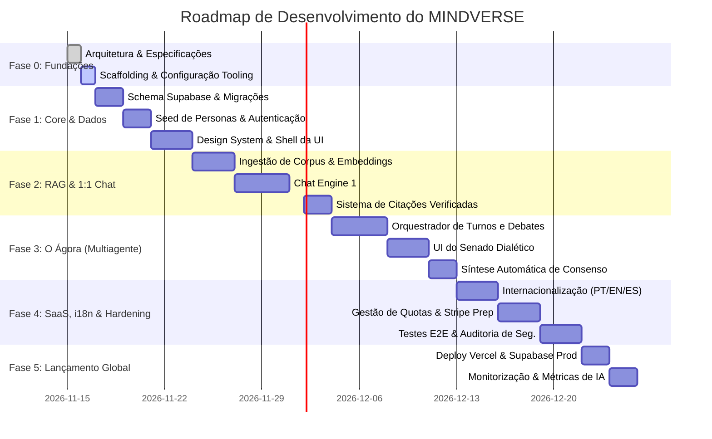

# MINDVERSE — Roteiro de Desenvolvimento (Development Roadmap)

## 1. Visão das Fases de Execução

O desenvolvimento do MINDVERSE está estruturado em 6 fases lógicas, com entregáveis incrementais e marcos de validação técnica e de produto.

---

## 2. Detalhe das Fases

### Fase 0: Arquitetura, Planeamento e Preparação (Atual)
- **Objetivo**: Fixar todas as bases teóricas, especificações e documentação técnica antes de iniciar a escrita de código de produto.
- **Entregáveis**:
  - Auditoria ambiental concluída.
  - Especificações arquitetónicas completas (`docs/`).
  - `.env.example` e `README.md` canónicos.
- **Critério de Aceitação**: Aprovação do plano pelo decisor técnico.

---

### Fase 1: Infraestrutura Base, Autenticação e Design System
- **Objetivo**: Estabelecer o repositório, configuração TypeScript estrita, migrações no Supabase e a fundação visual da aplicação.
- **Entregáveis**:
  - Projeto Vite + React 19 + TypeScript + Tailwind CSS inicializado.
  - ESLint, Prettier, Husky e lint-staged configurados.
  - Migrações SQL aplicadas no Supabase (perfis, personalidades, sessões).
  - Seed inicial das 11 personalidades do Cohort Genesis (incluindo Flávio Josefo).
  - Fluxo de autenticação completo (Email/Password + OAuth com Supabase Auth).
  - Layout mestre: Sidebar, seletor de personas, topo com métricas de quota e modo escuro/claro.
- **Critério de Aceitação**: Login funcional com criação automática de perfil em `profiles` e catálogo de personas renderizado com dados do banco.

---

### Fase 2: Motor RAG e Chat Dialógico 1:1
- **Objetivo**: Permitir conversas interativas e fluidas com cada persona, com suporte a streaming e citações históricas.
- **Entregáveis**:
  - Script de ingestão e chunking de textos em domínio público.
  - Função RPC `match_personality_chunks` com pgvector e HNSW.
  - Edge Function / Serverless Endpoint de Chat com streaming Server-Sent Events (SSE).
  - Componente de Chat no frontend com renderização de markdown e links para citações originais (drawer de referências).
- **Critério de Aceitação**: Tempo de primeiro token < 400ms em streaming; resposta da persona com citações fundamentadas no corpus.

---

### Fase 3: O Ágora — Simulador de Debate Multiagente
- **Objetivo**: Convocação de mesas-redondas entre 2 a 5 personalidades com mediação e síntese.
- **Entregáveis**:
  - Orquestrador de turnos inter-agentes no backend (deliberação circular e réplica baseada em contexto).
  - Interface do Ágora com indicador visual de orador ativo, histórico de debate segmentado e botão para intervenção do utilizador.
  - Agente Moderador gerando relatório de convergência/divergência após a conclusão das rondas.
  - Capacidade de exportar a transcrição e o relatório em formato Markdown e PDF.
- **Critério de Aceitação**: Debate executado de forma autónoma respeitando as personalidades de cada pensador e produzindo síntese conclusiva.

---

### Fase 4: Internacionalização, Controlo de Custos e Hardening
- **Objetivo**: Preparação do produto para tráfego internacional seguro e financeiramente controlado.
- **Entregáveis**:
  - i18next configurado com suporte integral a Português, Inglês e Espanhol.
  - Ledger de auditoria de tokens (`usage_ledger`) contabilizando consumo por pedido.
  - Verificação de limites de plano (Seeker vs. Scholar) e bloqueio gracioso ao atingir a quota diária.
  - Testes unitários com Vitest e testes E2E com Playwright cobrindo fluxos críticos (autenticação, chat, criação de debate).
  - Auditoria de segurança de dependências e testes de injeção de prompt.
- **Critério de Aceitação**: Cobertura de testes unitários > 80% nos serviços de domínio; zero chaves secretas no bundle do cliente.

---

### Fase 5: Lançamento em Produção e Observabilidade
- **Objetivo**: Publicação oficial na Vercel e Supabase com monitorização em tempo real.
- **Entregáveis**:
  - Ambientes de Staging e Produção segregados.
  - Configuração de telemetria de erros (Sentry) e métricas de desempenho de IA.
  - Documentação de onboarding de utilizador e tutorial interativo da primeira conversa.
- **Critério de Aceitação**: Aplicação no ar com pontuação Lighthouse > 90 em Performance e Acessibilidade.
