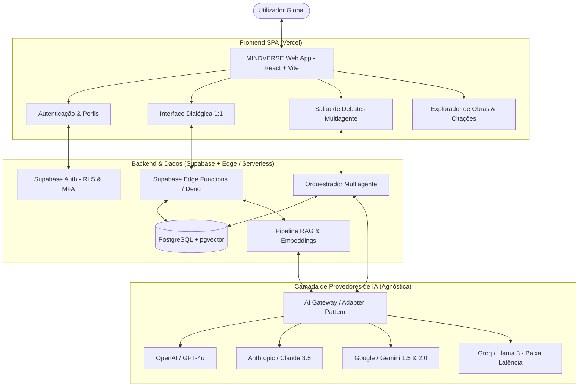

# MINDVERSE — Visão Geral do Projeto (Project Overview)

## 1. Sumário Executivo

**MINDVERSE** é uma plataforma SaaS global de inteligência humana aumentada por Inteligência Artificial. O seu propósito primordial é permitir que indivíduos, estudantes, investigadores e decisores conversem com representações intelectuais e psicológicas de grandes mentes da história (filósofos, cientistas, estrategas, inventores, artistas), beneficiem dos seus sistemas de raciocínio e convoquem debates multiagente para análise de dilemas complexos sob múltiplos prismas do pensamento humano.

O MINDVERSE transcende os chatbots convencionais ao combinar:
1. **Modelagem Cognitiva e Histórica Rigorosa**: Personalidades com mundivisão, premissas axiológicas, estilo dialético e corpus documental histórico.
2. **Arquitetura RAG de Alta Precisão (Retrieval-Augmented Generation)**: Respostas sustentadas em obras primárias, cartas, ensaios e fontes históricas indexadas via pesquisa vetorial (`pgvector`).
3. **Simulador Dialético Multiagente (The Agora / Senate)**: Orquestração síncrona/assíncrona de debates entre diferentes personalidades (ex.: Aristóteles vs. Friedrich Nietzsche vs. Ada Lovelace sobre ética da inteligência artificial), com mediação e síntese dialética.
4. **Fundação Internacional e Escalável**: Internacionalização nativa (i18n), segurança enterprise com Row-Level Security (RLS) no Supabase, e arquitetura desacoplada pronta para escalar para centenas de milhares de utilizadores globais.

---

## 2. Missão e Proposta de Valor

### 2.1 Missão
Democratizar o acesso à genialidade e sabedoria histórica acumulada da humanidade, transformando arquivos e ideias do passado em interlocutores dialógicos dinâmicos capazes de potenciar o pensamento crítico moderno.

### 2.2 Proposta de Valor por Segmento
- **Educação & Academia**: Aprendizagem imersiva por meio do diálogo socrático; análise crítica de teorias diretamente com os seus formuladores.
- **Liderança & Estratégia**: Resolução de dilemas de liderança, governação e estratégia convocando mentes como Marco Aurélio, Maquiavel, Sun Tzu ou Carl von Clausewitz.
- **Criatividade & Inovação**: Sessões de ideação interdisciplinares combinando perspetivas de visionários (ex.: Leonardo da Vinci, Nikola Tesla, Marie Curie).
- **Desenvolvimento Pessoal & Filosofia Prática**: Orientação estoica, existencialista ou humanista para decisões de vida e clareza mental.

---

## 3. Principais Módulos do Sistema

### 3.1 Módulo 1: Diálogo Unipessoal (1:1 Socratic Chat)
- Conversação aprofundada com uma personalidade histórica.
- Recuperação em tempo real de citações textuais e referências a capítulos/cartas originais.
- Ajuste de estilo e profundidade (Modo Pedagógico, Modo Erudito, Modo Provocatório/Socrático).

### 3.2 Módulo 2: O Ágora / Senado Intelectual (Multi-Agent Deliberation)
- Convocação de 2 a 5 personalidades para uma mesa-redonda.
- Definição do problema ou moção por parte do utilizador.
- Papel de Moderador / Síntese: Uma persona mediadora (ou o próprio utilizador) orienta as rondas de intervenção, réplicas, tréplicas e síntese de consensos/divergências irreconciliáveis.

### 3.3 Módulo 3: Base de Sabedoria Indexada (RAG Knowledge Engine)
- Repositório de obras em domínio público (Project Gutenberg, Perseus Digital Library, arquivos abertos).
- Chunking semântico com preservação de metadados (obra, tomo, ano, contexto histórico).
- Embeddings de alta dimensionalidade para retrieval de máxima relevância contextual.

### 3.4 Módulo 4: Gestão e Extensibilidade de Personas
- Schema padronizado de personas (DNA Intelectual): biografia, axiomas fundamentais, vieses conhecidos, obras fundamentais, modelo mental e tom de voz.
- Adição dinâmica de novas figuras sem necessidade de refatoração ou redeployment de código.

---

## 4. Personas do Lançamento (Cohort Genesis — 11 Personalidades)

| Categoria | Personalidade | Foco / Mundivisão | Principais Obras / Corpus |
| :--- | :--- | :--- | :--- |
| **Física & Conhecimento** | Albert Einstein | Experiências mentais (*Gedankenexperiment*), relatividade, pacifismo | Ensaios científicos e filosóficos, Correspondência |
| **Inovação & Universalidade**| Leonardo da Vinci | Curiosidade voraz, anatomia, engenharia, observação empírica | *Codex Leicester*, Cadernos de Notas |
| **Engenharia & Eletromagnetismo** | Nikola Tesla | Visão eletromagnética, invenção visionária, física aplicada | *My Inventions*, Artigos e Patentes |
| **Filosofia & Teleologia** | Aristóteles | Lógica formal, virtude e justa medida (*areté*), política, ética | *Ética a Nicómaco*, *Política*, *Metafísica* |
| **Filosofia & Maiêutica** | Sócrates | Método elêntico, dúvida metódica, autoexame ético | Diálogos de Platão, Xenofonte |
| **Filosofia & Prática** | Marco Aurélio | Estoicismo, disciplina mental, aceitação do fado, dever | *Meditações* |
| **Estratégia & Liderança** | Sun Tzu | Estratégia adaptativa, vitória sem batalha, cálculo racional | *A Arte da Guerra* |
| **Economia & Sociedade** | Adam Smith | Mão invisível, sentimentos morais, divisão do trabalho | *A Riqueza das Nações*, *Teoria dos Sentimentos Morais* |
| **Gestão & Modernidade** | Peter Drucker | Gestão orientada para resultados, trabalhador do conhecimento | *The Effective Executive*, *The Practice of Management* |
| **Ciência & Descoberta** | Marie Curie | Método experimental rigoroso, dedicação científica, pioneirismo | *Recherches sur les substances radioactives*, Cartas |
| **História Antiga & Testemunho** | Flávio Josefo (*Flavius Josephus*) | História judaica, Império Romano, conflitos do séc. I, 2.º Templo | *Antiguidades Judaicas*, *A Guerra dos Judeus*, *Contra Apião*, *Vida de Josefo* |

---

## 5. Estratégia de Internacionalização (i18n)
- **Idiomas Nativos de Interface**:
  - Português (PT)
  - Inglês (EN)
  - Francês (FR)
  - Espanhol (ES)
- **Capacidade Multilingue da IA**: As personalidades respondem no idioma selecionado pelo utilizador, preservando citações e termos canónicos no idioma original (ex.: Grego, Latim, Alemão, Francês) acompanhados de tradução e rigor filológico.

---

## 6. Modelo de Negócio (SaaS Tiers)
1. **Tier Gratuito (Seeker)**: Acesso diário limitado a conversas 1:1 com personas clássicas; debates multiagente pré-gravados/comunitários.
2. **Tier Pro (Scholar)**: Conversas 1:1 ilimitadas, debates multiagente com até 3 pensadores, acesso à base documental e citações verificadas, modelos de IA premium.
3. **Tier Enterprise / Academia (Institution)**: Debates com até 6 personalidades, inclusão de corpus privado, analytics institucionais, relatórios exportáveis com metodologia dialética.
